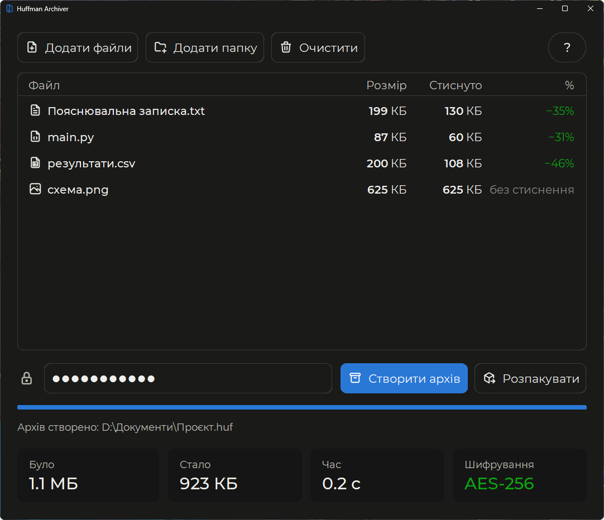
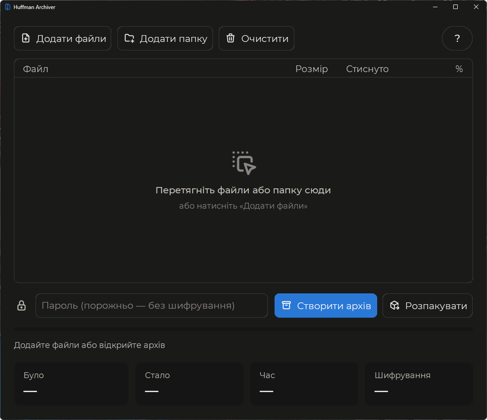
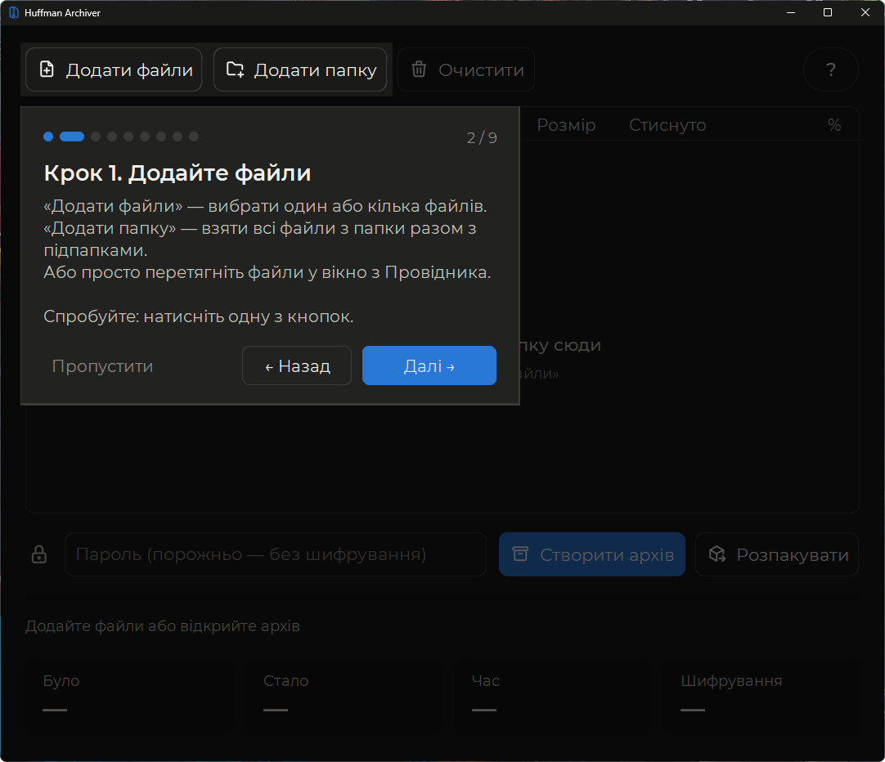
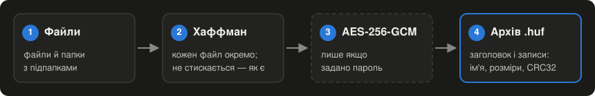
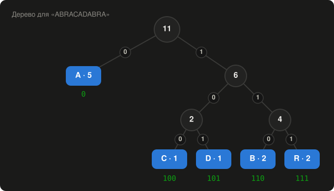

<div align="center">


# Huffman Archiver

**Архіватор файлів і папок з власною реалізацією стиснення Хаффмана та шифруванням AES-256**

[](https://github.com/s1xen7ag/huffman-archiver/actions/workflows/tests.yml)




</div>

## ✨ Можливості

- 🗜️ **Власний алгоритм Хаффмана.** Без zlib чи zip: дерево, коди й запис бітів написані з нуля.
- 🔐 **Шифрування AES-256-GCM.** Ключ отримується з пароля через PBKDF2 (600 000 ітерацій). Шифруються навіть імена файлів.
- 📁 **Файли й цілі папки** разом з підпапками. Їх можна вибрати кнопками або просто перетягнути у вікно з Провідника.
- 🧠 **Чесне стиснення.** Якщо файл не стискається (JPG, PNG, MP4, ZIP), програма зберігає його як є, а не роздуває.
- 🛡️ **Надійність.** Контрольна сума кожного файлу, захист від шкідливих архівів, жодних перезаписів, оригінали не змінюються.
- 🎓 **Вбудована інструкція.** При першому запуску програма сама покаже, яка кнопка за що відповідає.
- 🌙 **Сучасний темний інтерфейс** зі шрифтом Montserrat та іконками Tabler.

## 📸 Скріншоти

<table>
  <tr>
    <td align="center"><b>Перший запуск</b></td>
    <td align="center"><b>Покрокова інструкція</b></td>
  </tr>
  <tr>
    <td></td>
    <td></td>
  </tr>
</table>

## 🚀 Швидкий старт

### Windows

1. Встановіть [Python 3.10 або новіший](https://www.python.org/downloads/).
2. Завантажте програму: зелена кнопка **Code → Download ZIP** угорі сторінки, потім розпакуйте архів.
3. Двічі клацніть **`Встановити бібліотеки.bat`**. Це потрібно лише один раз.
4. Двічі клацніть **`main.pyw`**, і відкриється вікно програми.

Або через термінал:

```bash
git clone https://github.com/s1xen7ag/huffman-archiver.git
cd huffman-archiver
py -m pip install -r requirements.txt
py main.pyw
```

> [!TIP]
> Якщо команда `python` відкриває Microsoft Store, використовуйте `py`, як у прикладі вище.

### Linux (Ubuntu / Debian)

```bash
sudo apt install python3-tk python3-venv
git clone https://github.com/s1xen7ag/huffman-archiver.git
cd huffman-archiver
python3 -m venv .venv
.venv/bin/pip install -r requirements.txt
.venv/bin/python main.pyw
```

Архіви сумісні між системами: створений на Windows відкривається на Linux, і навпаки.

## 🧭 Як користуватися

1. **Додайте файли** кнопками «Додати файли» / «Додати папку» або перетягніть їх у вікно.
2. **Введіть пароль**, якщо архів треба зашифрувати. Порожнє поле означає архів без шифрування.
3. Натисніть **«Створити архів»** і виберіть, куди зберегти файл `.huf`.
4. Щоб дістати файли, натисніть **«Розпакувати»** і виберіть архів та папку. Файли з'являться в новій папці, нічого не перезапишеться.

Якщо щось забули, кнопка **«?»** у правому верхньому куті знову відкриє інструкцію.

> [!TIP]
> Щоб одразу спробувати, перетягніть у вікно папку **[`examples`](examples)** з тестовими файлами: текст, таблиця, великий файл на 4,6 МБ і фото. Що саме має вийти, описано в її [README](examples/README.md).

## ⚙️ Як це працює

> [!NOTE]
> Тут коротко. Докладний розбір кожного кроку з байтами, кодом і вимірами є в документі
> **[Як працює Huffman Archiver](docs/how-it-works.md)**. Там же пояснено, чому деякі файли не стискаються
> і чому архів буває на кілька десятків байтів більшим за файли.

### Від файлів до архіву

<p align="center">
  
</p>

Порядок важливий: **спершу стискаємо, потім шифруємо**. Зашифровані дані схожі на випадковий шум, і стиснути їх уже неможливо.

### Алгоритм Хаффмана на прикладі

Ідея проста: символи, які трапляються часто, отримують короткі коди, а рідкісні отримують довгі. Візьмемо слово `ABRACADABRA` (11 байт = 88 біт) і порахуємо, скільки разів трапляється кожна літера:

| Символ  | A | B | R | C | D |
|:--------|:-:|:-:|:-:|:-:|:-:|
| Частота | 5 | 2 | 2 | 1 | 1 |

Далі повторюємо одне й те саме: беремо два найрідші вузли й об'єднуємо їх у новий із сумарною частотою, доки не лишиться один корінь. Крок ліворуч дає біт `0`, праворуч — біт `1`.

<p align="center">
  
</p>

Код символу — це шлях від кореня до його листка. Найчастіша літера `A` отримала код з одного біта, а рідкісні `C` і `D` — з трьох. Закодоване слово:

```
A  B   R  A  C  A  D  A  B   R  A
0 110 111 0 100 0 101 0 110 111 0     → 23 біти замість 88
```

Щоб архів можна було розпакувати, разом із бітами зберігається таблиця частот. За нею програма будує те саме дерево. Для такого короткого слова таблиця більша за виграш, тому програма спершу рахує, чи стиснення справді зменшить розмір, і лише тоді стискає. На текстах і коді виходить приблизно **−30…−40 %**, на таблицях із цифрами (CSV) — близько **−45 %**, як на скріншоті вгорі.

Розпакування читає дані не по одному біту, а цілими байтами. Результат проходу деревом для кожної пари «вузол + байт» запам'ятовується в таблиці, тож навіть на Python розпакування працює швидко.

### Шифрування

- **Ключ з пароля.** Пароль перетворюється на 256-бітний ключ функцією PBKDF2-HMAC-SHA256: 600 000 ітерацій із випадковою «сіллю». Підбирати паролі так дуже повільно.
- **AES-256-GCM** не лише шифрує, а й перевіряє цілісність: неправильний пароль або змінений архів одразу помітні.
- Шифрується **весь вміст разом з іменами файлів**: без пароля не видно навіть, що лежить в архіві.

<details>
<summary><b>Будова файлу .huf, байт за байтом</b></summary>

<br>

| Поле      | Розмір  | Опис                                       |
|:----------|:--------|:-------------------------------------------|
| `HUFA`    | 4 байти | «магічні» байти, за якими впізнається формат |
| версія    | 1 байт  | зараз `1`                                  |
| прапорці  | 1 байт  | біт 0: вміст зашифровано                   |
| вміст     | решта   | записи файлів, відкриті або зашифровані    |

Вміст: кількість файлів (4 байти), далі для кожного файлу:

| Поле             | Розмір  | Опис                                    |
|:-----------------|:--------|:----------------------------------------|
| довжина імені    | 2 байти |                                         |
| ім'я             | N байт  | UTF-8, наприклад `Папка/звіт.docx`      |
| метод            | 1 байт  | `0`: як є, `1`: Хаффман                 |
| розмір оригіналу | 8 байт  |                                         |
| розмір даних     | 8 байт  |                                         |
| CRC32            | 4 байти | контрольна сума оригіналу               |
| дані             | …       |                                         |

Зашифрований вміст: `[сіль 16][nonce 12][шифротекст][тег автентичності 16]`.

Дані, стиснуті Хаффманом: `[довжина оригіналу 8][кількість різних байтів N 2][N × (байт 1 + частота 4)][біти, доповнені до цілого байта]`.

Усі числа записано у форматі little-endian.

</details>

### Надійність і безпека

- **Контрольна сума CRC32** кожного файлу: пошкоджений архів не розпакується «тихо» з помилками всередині.
- **Захист від шкідливих архівів.** Імена на кшталт `../../Windows/x.dll` відхиляються ще до того, як щось буде записано на диск.
- **Нічого не перезаписується.** Якщо папка вже існує, з'явиться `архів (2)`.
- **Без напівзаписаних архівів.** Архів спершу пишеться в тимчасовий файл і лише потім отримує справжнє ім'я.
- **Оригінали не змінюються:** програма їх лише читає.
- **Вікно не зависає.** Стиснення й шифрування працюють в окремому потоці.

<details>
<summary><b>Як працює перетягування файлів у вікно</b></summary>

<br>

Сам Tkinter не вміє приймати файли з Провідника, тому підключено розширення tkdnd (бібліотека `tkinterdnd2`). Вікно реєструється в системі як «приймач файлів». Коли файл тягнуть над вікном, приходить подія `<<DropEnter>>`, і рамка таблиці стає синьою. Коли кнопку миші відпускають, приходить `<<Drop>>` зі списком шляхів. Далі все працює так само, як після кнопки «Додати файли».

Якщо бібліотеку не встановлено, програма все одно запуститься, просто без перетягування.

</details>

## 🗂️ Структура проєкту

```
huffman-archiver/
├── main.pyw                    запуск програми (.pyw — без консолі на Windows)
├── Встановити бібліотеки.bat   встановлення бібліотек одним подвійним кліком
├── requirements.txt            список бібліотек
│
├── core/                       логіка, без вікон і кнопок
│   ├── huffman.py              алгоритм Хаффмана: дерево, коди, стиснення, розпакування
│   ├── crypto.py               шифрування AES-256-GCM, ключ з пароля через PBKDF2
│   └── archive.py              формат архіву .huf, створення і розпакування
│
├── ui/                         графічний інтерфейс (customtkinter)
│   ├── window.py               головне вікно, перетягування файлів у вікно
│   ├── file_table.py           таблиця файлів з іконками і кольоровими відсотками
│   ├── tutorial.py             покрокова інструкція з підказками (кнопка «?»)
│   ├── theme.py                кольори, шрифти, іконки
│   └── assets/                 шрифт Montserrat, іконки, значок програми
│
├── tests/
│   └── test_archiver.py        автоматичні тести логіки
│
├── examples/                   тестові файли, щоб спробувати стиснення
│
└── docs/
    ├── how-it-works.md         докладно: як працюють стиснення, шифрування і формат архіву
    └── …                       зображення і схеми для цієї сторінки
```

Логіка (`core`) нічого не знає про вікно. Її можна перевіряти тестами або підключити до іншого інтерфейсу, наприклад консольного, не змінивши жодного рядка.

## 🧪 Тести

14 автоматичних тестів перевіряють:

- стиснення: звичайний текст, усі 256 значень байта, дуже глибоке дерево, випадкові й порожні дані;
- шифрування: правильний і неправильний пароль;
- архів цілком: з паролем і без, пошкоджений файл, шкідливий архів, захист від перезапису.

GitHub запускає їх автоматично після кожної зміни на Windows і Linux. Значок «Тести» вгорі сторінки показує результат. Запустити тести вручну можна з папки програми:

```bash
py -m unittest -v
```

## 🎨 Сторонні ресурси

| Ресурс | Для чого | Ліцензія |
|:--|:--|:--|
| [customtkinter](https://github.com/TomSchimansky/CustomTkinter) | сучасні віджети для Tkinter | MIT |
| [cryptography](https://cryptography.io) | AES-256-GCM і PBKDF2 | Apache 2.0 / BSD |
| [tkinterdnd2](https://github.com/Eliav2/tkinterdnd2) | перетягування файлів у вікно | MIT |
| [Montserrat](https://github.com/JulietaUla/Montserrat) | шрифт інтерфейсу | SIL OFL 1.1 ([текст](ui/assets/fonts/LICENSE.txt)) |
| [Tabler Icons](https://tabler.io/icons) | іконки | MIT ([текст](ui/assets/icons/LICENSE.txt)) |

Шрифт підключається лише для цієї програми і в систему не встановлюється. Щоб змінити його, покладіть файли нового шрифту в `ui/assets/fonts` і змініть `FONT_NAME` у `ui/theme.py`.

---

<div align="center">

© 2026 [s1xen7ag](https://github.com/s1xen7ag). Усі права захищено.<br>
Код відкритий для перегляду. Копіювати й використовувати його можна лише з дозволу автора.

</div>
