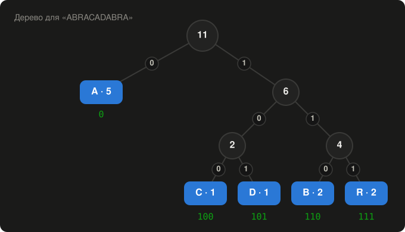

# Як працює Huffman Archiver

Тут докладно, крок за кроком, розібрано, що відбувається всередині програми: як працює стиснення, шифрування і формат архіву. Усі числа в документі отримано запуском коду самої програми.

Коротший огляд є на [головній сторінці](../README.md).

**Зміст**

1. [Чому дані взагалі можна стиснути](#1-чому-дані-взагалі-можна-стиснути)
2. [Алгоритм Хаффмана крок за кроком](#2-алгоритм-хаффмана-крок-за-кроком)
3. [Як це зроблено в коді](#3-як-це-зроблено-в-коді)
4. [Чому одні файли стискаються, а інші ні](#4-чому-одні-файли-стискаються-а-інші-ні)
5. [Шифрування](#5-шифрування)
6. [Формат файлу .huf на живому прикладі](#6-формат-файлу-huf-на-живому-прикладі)
7. [Захист і перевірки](#7-захист-і-перевірки)
8. [Швидкість і порівняння з ZIP](#8-швидкість-і-порівняння-з-zip)

---

## 1. Чому дані взагалі можна стиснути

Будь-який файл — це послідовність байтів, і кожен байт займає 8 бітів. Байт може мати 256 різних значень, але у звичайних файлах вони трапляються дуже нерівномірно.

Наприклад, у тексті головної сторінки (`README.md`, 16 602 байти):

| Байт | Що це | Скільки разів |
|:--|:--|--:|
| `D0` | перший байт більшості українських літер | 3 449 |
| пробіл | | 1 939 |
| `D1` | перший байт решти українських літер | 1 929 |
| `B0` | другий байт літери «а» | 487 |
| `BE` | другий байт літери «о» | 432 |

Зі 256 можливих значень байта в цьому файлі трапляється лише 150. Решта 106 не трапляються жодного разу.

Українська літера в кодуванні UTF-8 займає 2 байти, і перший з них майже завжди `D0` або `D1`. Тому ці два байти дуже часті, і українські тексти добре стискаються.

Якщо часті байти записувати коротшими кодами, а рідкісні довшими, у сумі вийде менше бітів. Саме це робить алгоритм Хаффмана.

Стиснення **без втрат**: після розпакування файл точнісінько такий, як був, до останнього біта. Програма це ще й перевіряє контрольною сумою (див. [розділ 7](#7-захист-і-перевірки)).

## 2. Алгоритм Хаффмана крок за кроком

Розберемо слово `ABRACADABRA`: 11 байтів, тобто 88 бітів.

### Крок 1. Рахуємо частоти

| Символ  | A | B | R | C | D |
|:--------|:-:|:-:|:-:|:-:|:-:|
| Частота | 5 | 2 | 2 | 1 | 1 |

### Крок 2. Будуємо дерево

Кожен символ спочатку — окремий вузол. Повторюємо одне й те саме: беремо **два вузли з найменшою частотою** й об'єднуємо їх у новий вузол із сумарною частотою.

| Крок | Об'єднуємо | Новий вузол |
|:-:|:--|:-:|
| 1 | C (1) + D (1) | 2 |
| 2 | B (2) + R (2) | 4 |
| 3 | [C D] (2) + [B R] (4) | 6 |
| 4 | A (5) + [C D B R] (6) | **11** — корінь |

Коли частоти однакові, програма бере вузли в сталому порядку, за значенням байта. Тому і при стисненні, і при розпакуванні дерево виходить однаковим.

<p align="center">
  
</p>

### Крок 3. Отримуємо коди

Код символу — це шлях від кореня до його листка: крок ліворуч дає `0`, праворуч — `1`.

| Символ | Частота | Код | Довжина |
|:-:|:-:|:-:|:-:|
| A | 5 | `0` | 1 біт |
| C | 1 | `100` | 3 біти |
| D | 1 | `101` | 3 біти |
| B | 2 | `110` | 3 біти |
| R | 2 | `111` | 3 біти |

Найчастіший символ отримав найкоротший код.

Важлива властивість: **жоден код не є початком іншого**. `0` не є початком `100`, `110` не є початком `111` і так далі. Тому коди можна записувати підряд без роздільників і все одно однозначно розібрати їх назад.

### Крок 4. Кодуємо

Замінюємо кожен символ його кодом:

```
A  B   R  A  C  A  D  A  B   R  A
0 110 111 0 100 0 101 0 110 111 0
```

Виходить 23 біти: `01101110100010101101110`. Записати у файл можна лише цілі байти, тому останній байт доповнюється нулем:

```
01101110  10001010  11011100
   6E        8A        DC
```

Отже, 3 байти замість 11.

### Крок 5. Розпаковуємо

Читаємо біти по одному і рухаємося деревом від кореня: `0` — ліворуч, `1` — праворуч. Дійшли до листка — записуємо символ і повертаємося до кореня.

```
0          → A
1 1 0      → B
1 1 1      → R
0          → A
…
```

Тут є пастка: доданий у кінці нуль-доповнення теж прочитається, як код `0`, і дасть **зайву літеру A**. Тому разом з бітами зберігається довжина оригіналу (11), і все зайве після 11-го символу відкидається.

### Що зберігається разом із бітами

Щоб розпакувати дані, потрібне те саме дерево. Програма зберігає не дерево, а **таблицю частот**, і при розпакуванні будує з неї дерево заново, так само, як на кроці 2.

```
[довжина оригіналу: 8 байт][скільки різних байтів N: 2 байти]
N × [байт: 1 байт][частота: 4 байти]
[закодовані біти]
```

Для `ABRACADABRA` один лише заголовок з таблицею займає 10 + 5 × 5 = **35 байтів**, тобто більше за саме слово. Програма рахує розмір результату **ще до стиснення**. Якщо виграшу немає, вона зберігає дані як є. Тому `ABRACADABRA` в архіві лежатиме нестиснутим.

Для великих файлів таблиця дрібниця: навіть якщо трапляються всі 256 значень байта, вона займає 10 + 256 × 5 = 1 290 байтів.

## 3. Як це зроблено в коді

Увесь алгоритм — у файлі [`core/huffman.py`](../core/huffman.py).

| Функція | Що робить |
|:--|:--|
| `build_tree` | будує дерево за таблицею частот |
| `make_codes` | обходить дерево і складає коди: ліворуч `0`, праворуч `1` |
| `compress` | рахує частоти, перевіряє, чи буде виграш, і кодує дані |
| `decompress` | відновлює дерево з таблиці частот і розкодовує біти |

Дерево будується через **чергу з пріоритетом** (`heapq`). Вона щоразу видає вузол з найменшою частотою, тож два найрідші вузли беруться за мить. Головна частина `build_tree` (скорочено):

```python
heap = [(count, order, symbol) for order, (symbol, count) in enumerate(sorted(freq.items()))]
heapq.heapify(heap)
while len(heap) > 1:
    count1, _, left = heapq.heappop(heap)    # найрідший вузол
    count2, _, right = heapq.heappop(heap)   # другий найрідший
    heapq.heappush(heap, (count1 + count2, order, (left, right)))
    order += 1
```

Кілька рішень, які роблять програму швидкою на Python:

- **Дані обробляються шматками по 256 КБ.** Так видно прогрес у вікні і не потрібно тримати в пам'яті величезний рядок бітів.
- **Біти перетворюються на байти одним кроком:** рядок `"0110…"` → число `int(bits, 2)` → байти. Цикл по кожному біту не потрібен.
- **Розпакування читає не по біту, а цілими байтами.** Для кожної пари «вузол дерева + прочитаний байт» результат обчислюється один раз і запам'ятовується в таблиці переходів. Далі програма просто бере готову відповідь.

Складність: частоти рахуються за один прохід по даних, а дерево будується з не більше ніж 256 листків. Тож час росте пропорційно розміру файлу.

## 4. Чому одні файли стискаються, а інші ні

Хаффман виграє лише тоді, коли байти трапляються нерівномірно. Виміри на файлах самої програми:

| Файл | Розмір | Хаффман |
|:--|--:|:-:|
| `README.md` (текст українською) | 16 602 Б | −31 % |
| `ui/window.py` (код) | 24 040 Б | −32 % |
| `core/huffman.py` (код) | 8 406 Б | −27 % |
| `docs/screenshot-main.png` (картинка PNG) | 66 574 Б | не стискається |

| Тип файлу | Що буде | Чому |
|:--|:--|:--|
| тексти, код, CSV, HTML | стискаються на 25–45 % | символи трапляються нерівномірно |
| фото JPG і PNG, відео MP4, музика MP3 | зберігаються як є | формат уже стиснув дані |
| архіви ZIP, RAR, 7z | зберігаються як є | це вже стиснуті дані |
| документи Word, Excel, PowerPoint (.docx, .xlsx, .pptx) | зберігаються як є | усередині кожен такий файл — ZIP-архів |
| PDF | зазвичай як є | вміст стиснутий усередині файлу |

У стиснутих даних усі значення байтів трапляються майже однаково часто. Коротших кодів для «частих» байтів просто немає кому давати.

### Чому архів буває трохи більшим за файли

Якщо стиснути нічого, файли зберігаються як є, але архіву все одно потрібні службові дані:

| Що | Скільки байтів |
|:--|--:|
| заголовок архіву (`HUFA`, версія, прапорці) і кількість файлів | 10 |
| запис про кожен файл: довжина імені, метод, два розміри, CRC32 | 23 + ім'я файлу |
| якщо є пароль: сіль, nonce і тег автентичності | 44 |

Ім'я записується в UTF-8: латинська літера займає 1 байт, українська — 2.

Наприклад, один відеофайл з іменем у 40 байтів і з паролем: 10 + 23 + 40 + 44 = **117 байтів**. Саме таке повідомлення показує програма: «Архів більший за файли на 117 Б». На файлі у 30 МБ це 0,0004 %.

## 5. Шифрування

Шифрування — у файлі [`core/crypto.py`](../core/crypto.py). Використано бібліотеку `cryptography`.

### Ключ з пароля: PBKDF2

Пароль не можна використати як ключ напряму: він короткий і передбачуваний. Ключ AES (256 бітів) отримується функцією **PBKDF2-HMAC-SHA256**:

- до пароля додається випадкова **сіль** (16 байтів), нова для кожного архіву. Однаковий пароль дає різні ключі, і заздалегідь підготовлені таблиці паролів не допоможуть;
- пароль із сіллю хешується **600 000 разів**. На цьому комп'ютері це ≈0,07 с, і користувач цього не помічає. Але перебір мільйона паролів займе ≈19 годин замість секунди.

### AES-256-GCM

**AES-256** — стандарт шифрування, який використовують банки й держустанови. Режим **GCM** не лише шифрує, а й рахує **тег автентичності** (16 байтів), своєрідний «відбиток» даних і ключа. При розпакуванні тег перевіряється. Якщо пароль неправильний або хтось змінив хоч один байт архіву, програма повідомляє про помилку, а не видає «сміття».

Будова зашифрованого вмісту:

```
[сіль: 16 байт][nonce: 12 байт][зашифровані дані][тег автентичності: 16 байт]
```

**Nonce** — випадкове одноразове число. Без нього однакові дані з однаковим ключем давали б однаковий шифротекст.

Шифрується **весь вміст архіву, разом з іменами файлів**. Без пароля не видно навіть, які файли лежать усередині.

### Чому спершу стиснення, а потім шифрування

Зашифровані дані виглядають як випадковий шум. Той самий `README.md` після шифрування:

| | Різних значень байта | Найчастіший байт |
|:--|:-:|:--|
| звичайний текст | 150 з 256 | `D0`: 3 449 разів |
| після шифрування | всі 256 | 46–88 разів кожен, майже порівну |

У зашифрованих даних немає частих байтів, тож Хаффману нічого скорочувати. Програма перевірила це сама: стиснути зашифрований `README.md` вона відмовилася. Тому порядок у програмі такий: **спершу стиснути кожен файл, потім зашифрувати весь архів**.

## 6. Формат файлу .huf на живому прикладі

Ось справжній архів, створений програмою з одного файлу `abc.txt`, у якому записано `ABRACADABRA`, без пароля. Він займає 51 байт:

```
48 55 46 41 01 00 01 00 00 00 07 00 61 62 63 2E 74 78 74 00
0B 00 00 00 00 00 00 00 0B 00 00 00 00 00 00 00 5F 6B E9 9A
41 42 52 41 43 41 44 41 42 52 41
```

| Байти | Значення | Що означає |
|:--|:--|:--|
| `48 55 46 41` | `HUFA` | «магічні» байти, за якими програма впізнає свій формат |
| `01` | 1 | версія формату |
| `00` | 0 | прапорці: біт 0 = 0, тобто не зашифровано |
| `01 00 00 00` | 1 | кількість файлів |
| `07 00` | 7 | довжина імені |
| `61 62 63 2E 74 78 74` | `abc.txt` | ім'я файлу (UTF-8) |
| `00` | 0 | метод: 0 = як є, бо слово закоротке для стиснення |
| `0B 00 00 00 00 00 00 00` | 11 | розмір оригіналу |
| `0B 00 00 00 00 00 00 00` | 11 | розмір збережених даних |
| `5F 6B E9 9A` | `9AE96B5F` | контрольна сума CRC32 |
| `41 42 52 41 …` | `ABRACADABRA` | самі дані |

Числа записано у форматі **little-endian**, молодшим байтом уперед. Тому 11 виглядає як `0B 00 00 …`, а CRC32 `9AE96B5F` — як `5F 6B E9 9A`.

Якщо задано пароль, після перших 6 байтів (`HUFA`, версія, прапорці) іде вже зашифрований блок. Прапорець тоді дорівнює `01`.

Код формату — у файлі [`core/archive.py`](../core/archive.py).

## 7. Захист і перевірки

- **Контрольна сума CRC32.** Для кожного файлу при архівуванні рахується CRC32 оригіналу, а при розпакуванні — ще раз. Якщо суми не збігаються, програма повідомляє, що файл пошкоджено, а не «тихо» видає зіпсовані дані.
- **Захист від шкідливих архівів.** Ім'я файлу в архіві може бути підроблене, наприклад `../../Windows/x.dll`, щоб записати файл поза вибраною папкою. Програма перевіряє **всі** імена ще до того, як щось записати на диск, і такі архіви відхиляє.
- **Нічого не перезаписується.** Файли розпаковуються в нову папку з назвою архіву. Якщо вона вже існує, з'явиться `назва (2)`.
- **Без напівзаписаних архівів.** Архів спершу пишеться в тимчасовий файл `.tmp` і лише після успішного запису отримує справжнє ім'я. Якщо станеться збій, наполовину записаного архіву не залишиться.
- **Оригінали тільки читаються.** Програма нічого не змінює і не видаляє.

Усе це перевіряють 14 автоматичних тестів у [`tests/test_archiver.py`](../tests/test_archiver.py). GitHub запускає їх після кожної зміни на Windows і Linux.

## 8. Швидкість і порівняння з ZIP

**Швидкість.** На 4,6 МБ тексту (`README.md`, повтореного кілька сотень разів) на цьому комп'ютері:

| | Результат |
|:--|:--|
| розмір після стиснення | 2,94 МБ (−36 %) |
| стиснення | 0,34 с |
| розпакування | 0,27 с |

Стиснення й шифрування виконуються у фоновому потоці, тож вікно під час роботи не зависає.

**Порівняння з ZIP.** Ті самі файли, стиснуті методом ZIP (deflate, максимальний рівень):

| Файл | Хаффман | ZIP |
|:--|:-:|:-:|
| `README.md` | −31 % | −65 % |
| `ui/window.py` | −32 % | −70 % |
| `core/huffman.py` | −27 % | −62 % |
| `docs/screenshot-main.png` | не стискається | −6 % |

ZIP стискає краще, бо поєднує **два** алгоритми:

1. **LZ77** шукає повтори цілих фрагментів. Якщо слово `архів` або рядок `self.` уже траплялися, замість них записується коротке посилання «повтори N байтів, що були M байтів тому».
2. **Хаффман** потім стискає те, що лишилося, так само, як у цій програмі.

Отже, ця програма реалізує другу половину ZIP. Хаффман економить лише на частоті окремих байтів і не бачить повторів цілих слів, тому на текстах дає 25–45 %. Логічне продовження проєкту — додати перед Хаффманом етап LZ77, і тоді результат наблизиться до ZIP.
